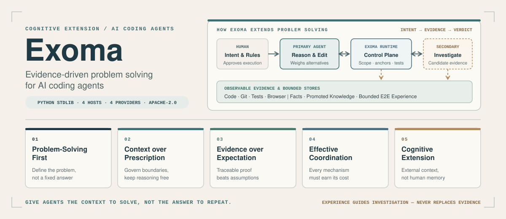

<div align="center">



# Exoma

**Evidence-driven problem solving for AI coding agents.**

[](LICENSE)
[](https://www.python.org/downloads/)
[](docs/installation.md#requirements)
[](docs/installation.md)
[](CHANGELOG.md)

**[Quick start](#quick-start)** · [Philosophy](docs/philosophy.md) · [Architecture](docs/architecture/README.md) · [Contributing](CONTRIBUTING.md) · [Docs](docs/README.md)

</div>

---

## Why Exoma?

Coding agents on real repositories spend most of their context window hunting for files,
tracing callers, and guessing conventions before making a single edit — or they follow a
user's assumptions without checking the code.

**Exoma** is a zero-dependency Python runtime and CLI (`exoma`) that sits around your primary
coding agent (**Claude Code**, **Agy**, **Codex**, or **OpenCode**). It moves broad repository
inspection to a secondary agent in a separate context, enforces deterministic plan/scope/verify
boundaries, and returns structured, anchored **evidence candidates** (`digest` + `file:line`
anchors + artifact reference) so the primary agent can focus on reasoning and implementation.

> **Give agents the context to solve, not the answer to repeat.**

---

## How it works

<p align="center">

</p>

<sub>Full verified flow, execution governance, browser pipeline, and storage boundaries: [docs/architecture](docs/architecture/README.md).</sub>

### Who owns what

| Participant | Primary authority | Role |
| --- | --- | --- |
| **Human** | Problem intent & authorization | Sets goals and constraints; approves execution (`/.execute -y`) and key trade-offs |
| **Evidence sources** | Observable facts | Repository code, Git state, tests, browser artifacts, and project config |
| **Primary agent** | Semantic reasoning & edits | Evaluates evidence, weighs alternatives, writes code (`Claude Code`, `Agy`, `Codex`, `OpenCode`) |
| **Exoma runtime** | Deterministic governance | Routing, sessions, locks, redaction, anchor checks, scope/approval gates, test & browser execution |
| **Secondary agent** | Bounded investigation | Broad read-only repository exploration and review (`opencode`, `codex`, `agy`, `claude`); returns **evidence candidates**, not truth |

---

## Core philosophy

Exoma is grounded in five principles (explained in full in **[docs/philosophy.md](docs/philosophy.md)**):

1. **Problem-Solving First** — People define the problem and constraints; agents keep room to
   investigate, form hypotheses, and evaluate alternatives.
2. **Context over Prescription** — Govern critical boundaries (authorization, scope, security,
   verification) deterministically rather than micromanaging reasoning steps.
3. **Evidence over Expectation** — Ground claims in traceable, reviewable evidence; *experience
   should guide investigation, not replace evidence*.
4. **Effective Coordination over Unnecessary Complexity** — Coordinate agents, tools, and
   context only when the task benefits; more agents or context is not automatically better.
5. **Cognitive Extension** — Act as an external problem-solving environment (inspired by the
   *Extended Mind Thesis* and distributed cognition), without claiming human-like memory or
   cognition.

---

## What is implemented today

- **Context & knowledge support:** delegated exploration/analysis, optional Graphify file
  leads, anchored project facts (`.workflow/data/facts.jsonl`), whole-artifact evidence reuse
  (`evidence.jsonl`), and manually promoted Git-tracked project knowledge
  (`docs/project-knowledge/`, checked for validity and branch applicability).
- **Deterministic runtime & coordination:** detached async jobs with heartbeats and bounded
  recovery, per-session isolation and locks (`session-init`), provider routing across 4 hosts and 4
  secondary providers, compact `result.json` pointers, optional explicit `/.fanout` opt-in, secret
  redaction, and response-contract validation.
- **Execution & verification governance:** recorded plans (`plan-record`), user-approved
  execution scope (`execute-begin` / `execute-end` with Git tree snapshots), allowlisted
  runtime test execution with input-fingerprinted test reuse, execution-scoped `[FOLLOWUP]`
  finding tracking across verification rounds, and derived verification verdicts that keep
  *planned*, *implemented*, and *verified* distinct.
- **Browser verification & bounded experience:** `verify-browser` 3-stage pipeline (draft →
  supervised Playwright player → review), 4-origin failure classification (`app`, `harness`,
  `scenario`, `unknown`), and origin-scoped browser experience (`.workflow/data/e2e-knowledge.jsonl`,
  placeholder-only, no credentials).
- **Operational & evaluation telemetry:** `exoma report` and offline measurement tools covering
  usage/cost, verification outcomes, task streams, browser runs, and evidence/fact lifecycles.

---

## Quick start

```bash
uv tool install exoma        # or: pipx install exoma  (Python 3.11+, stdlib-only runtime)
exoma install --dry-run      # preview host/provider setup changes
exoma install                # choose primary host & secondary provider
```

Initialize inside a project (Claude Code / Agy: `/.init` & `/.doctor`; Codex: `$exoma-init` &
`$exoma-doctor`; or CLI with `--host <host>`, e.g. `exoma init --work-dir . --host codex`):

```text
you:          where is the authentication logic in this project?
primary:      [INTENT] explore — location question
              (runs .workflow/run.sh explore --session '<SESSION_ID>' --task '...')
```

| Command | Type | Purpose |
| --- | --- | --- |
| `init` / `upgrade` / `doctor` / `session-init` | local | Set up `.workflow/`, refresh after updates, check readiness, register sessions |
| `sweep` / `clean` | local | Inspect working-tree changes / prune old jobs, facts, sessions |
| `explore` / `analyze` / `plan` | delegated | Map code, investigate causes, gather planning evidence (opt-in `/.fanout`) |
| `verify` / `verify-browser` | delegated | Verify changes with review + runtime tests / real Playwright run |
| `promote-*` | local | Turn verified evidence into Git-tracked `docs/project-knowledge/` |

Implementation (`/.execute -y`) stays in the primary agent and opens a scope-tracked runtime
execution. Full install, update, uninstall, and recovery steps:
[docs/installation.md](docs/installation.md) and [docs/reference.md](docs/reference.md).

---

## Limitations (honest boundaries)

Exoma is not free and does not guarantee correctness:

- **Latency & cost:** delegated calls take seconds to minutes; localized, known edits are often
  faster directly ([when to use](docs/team-guide/when-to-use.md)).
- **Provenance ≠ semantic truth:** verified `file:line` anchors and schema checks do not prove
  an agent's interpretation is right or eliminate model hallucinations.
- **Uneven host & provider enforcement:** read-only boundaries, shell-write hooks, and sandbox
  grants differ by host and provider ([Security](docs/security.md)).
- **Partial telemetry & stale persistence:** stored facts/knowledge can drift; task telemetry
  is not a complete semantic history of how a problem was solved.

Full technical list: **[docs/limitations.md](docs/limitations.md)**.

---

## Contributing

Contributions of every kind are welcome — bug fixes, reliability improvements, tests, provider
compatibility, performance work, and documentation clarity.

- Start with **[CONTRIBUTING.md](CONTRIBUTING.md)** for repository layout, isolated local
  setup, test commands, and our lightweight review process.
- Exoma is the implementation source of truth; [agent-workflow](https://github.com/dammar01/agent-workflow)
  is its companion research and release-staging repository ([relationship policy](docs/development.md#development-and-research-relationship)).

---

## Documentation

| Document | Purpose |
| --- | --- |
| [docs/philosophy.md](docs/philosophy.md) | Core principles, participant authority, knowledge vs. task state vs. experience |
| [docs/architecture/README.md](docs/architecture/README.md) | Verified request flow, execution governance, browser pipeline, storage |
| [docs/installation.md](docs/installation.md) | Requirements, install, per-project setup, updating, uninstalling |
| [docs/team-guide/README.md](docs/team-guide/README.md) | Day-to-day usage: when to use, task framing, examples, troubleshooting |
| [docs/reference.md](docs/reference.md) | Authoritative technical reference: commands, config, jobs, hosts, sessions |
| [docs/runtime-contracts.md](docs/runtime-contracts.md) | Enforced vs. non-enforced `.workflow/config.json` contracts |
| [docs/security.md](docs/security.md) | Per-provider read/write boundaries and redaction |
| [docs/limitations.md](docs/limitations.md) | Known epistemic, host, provider, and operational limits |
| [docs/evaluation/metrics.md](docs/evaluation/metrics.md) | Implemented metric categories, versioned registry, and interpretation limits |
| [CONTRIBUTING.md](CONTRIBUTING.md) / [docs/development.md](docs/development.md) | External contribution guide and maintainer/staging workflow |
| [CHANGELOG.md](CHANGELOG.md) / [RELEASE.md](RELEASE.md) | Release history and release procedure |

Full index and documentation rules: [docs/README.md](docs/README.md).

---

## License

Apache License 2.0 — see [LICENSE](LICENSE).

```text
Copyright 2026 dammar01
```
