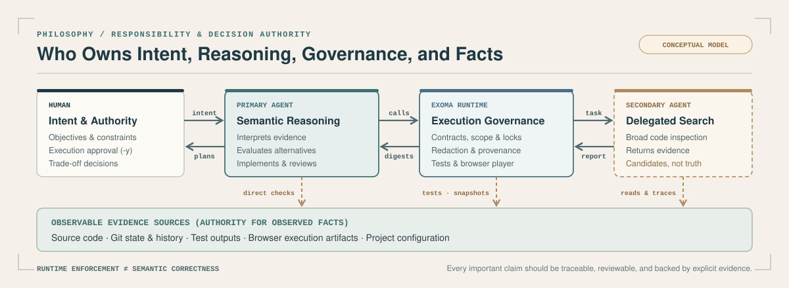

# Exoma Philosophy

Exoma is built around a straightforward premise: how well an AI agent solves a problem
depends not only on the model, but on the context it sees, the evidence it checks, the
boundaries governing its actions, and how work is coordinated around it.

This document explains the principles behind Exoma as it exists today. For exact runtime
behavior and contracts, see [docs/architecture](architecture/README.md),
[docs/reference.md](reference.md), and [docs/runtime-contracts.md](runtime-contracts.md).

---

## 1. Problem-Solving First

Exoma exists to support and improve how AI agents investigate and solve problems — not merely
to make an agent replay a human's checklist.

People define the problem, objectives, and constraints. Within those boundaries, the agent
retains room to inspect the repository, form hypotheses, weigh alternatives, and reach an
evidence-supported conclusion.

**Core stance:** the system supports investigation rather than prescribing an expected answer.

## 2. Context over Prescription

Provide relevant context and resources so the agent understands the real environment before
choosing an approach, instead of micromanaging every reasoning step.

Constraints remain essential where they protect real boundaries:

- **User authorization** — explicit approval before code execution (`/.execute -y`) or
  destructive actions.
- **Execution scope** — keeping edits bound to the approved plan's files and project root.
- **Data integrity & security** — secret redaction, read-only delegation roles, and
  origin/write guards during browser runs.
- **Verification obligations** — separating implemented code from verified work.
- **Explicit project requirements** — project configuration, test allowlists, and tracked
  conventions.

The distinction is deliberate: **govern critical boundaries deterministically; leave semantic
reasoning to the agent.**

## 3. Evidence over Expectation

Conclusions and recommendations should rest on observable, traceable evidence rather than
assumptions or confirming what a user hoped to hear.

In Exoma, evidence can come from:

- Source code and repository structure.
- Git state, diffs, and history.
- Test outputs and runtime observations.
- Browser execution artifacts (steps, network ledger, console/page observations).
- Project configuration.
- Delegated investigation reports.
- Previously recorded facts and promoted project knowledge.

Not every source is automatically authoritative. Graph leads, agent explanations, stored
facts, and delegated digests are **inputs to evaluate**, not ground truth.

> **Experience should guide investigation, not replace evidence.**

Evidence provenance and semantic correctness are also distinct: a valid `file:line` citation
proves a line exists at the recorded hash, not that an agent's interpretation of that line is
correct.

## 4. Effective Coordination over Unnecessary Complexity

Exoma coordinates agents, models, tools, context, and execution according to what a problem
actually needs.

- More agents do not automatically produce better solutions.
- More context, more orchestration steps, or more persistent data do not automatically improve
  problem-solving quality.
- Delegation introduces latency, token cost, and summarization loss; localized tasks are often
  better handled directly.

Every mechanism in Exoma must earn its complexity through concrete value in effectiveness,
reliability, or execution quality.

## 5. Cognitive Extension

Exoma acts as an external extension of an agent's problem-solving environment. Its mechanisms
extend what a primary agent can draw on beyond its immediate context window: delegated
repository inspection, structured digests with source anchors, project facts, promoted project
knowledge, task/execution state, and verification tooling.

Conceptually, this draws inspiration from the *Extended Mind Thesis* and *distributed
cognition* — the idea that problem-solving emerges from an agent working with external tools
and structured representations.

**Boundary:** this is a design analogy, not a claim that Exoma reproduces human cognition,
consciousness, or human-equivalent memory.

---

## 6. Human, Agent, and Runtime Responsibilities

<strong>[Conceptual]</strong> Responsibility and decision flow. For the verified runtime implementation, see <a href="architecture/README.md">docs/architecture</a>.

| Responsibility | Primary authority | Role in problem-solving |
| --- | --- | --- |
| **Problem intent** | Human | Sets objectives, constraints, and development priorities |
| **Observable facts** | Evidence sources | Current repository, Git state, tests, runtime, browser artifacts, and configuration |
| **Semantic investigation** | Primary agent | Interprets evidence, forms hypotheses, and explores alternatives |
| **Solution evaluation** | Primary agent | Compares approaches against project conditions and explicit criteria |
| **Execution governance** | Exoma runtime and host controls | Enforces supported contracts, scope, permissions, and execution state |
| **Delegated investigation** | Secondary agent | Gathers and organizes evidence within its actual capabilities and access boundaries |
| **Human authorization** | Human | Approves execution, scope changes, and trade-offs requiring human authority |

Key operational distinctions:

- **Runtime enforcement does not prove semantic correctness.** Deterministic hooks and schema
  checks validate structure, scope, and provenance — not whether a design is right.
- **A secondary-agent report is an evidence candidate, not unquestionable truth.** The primary
  agent remains responsible for verifying critical claims against source.
- **Recommendations must show their basis.** Claims should carry traceable evidence,
  assumptions, alternatives, and explicit uncertainty.
- **Evidence can challenge initial expectations.** When observable evidence contradicts a
  user's starting assumption, the agent should surface that finding rather than force-fit the
  expected answer.
- **Humans hold intent authority; agents hold bounded autonomy.** Humans authorize execution
  and trade-offs, without needing to manually micromanage every routine read or investigation
  step inside authorized boundaries.

> **Every important claim and recommendation should be traceable, reviewable, and supported by
> explicit evidence and evaluation criteria.**

---

## 7. Evidence, Project Knowledge, Task State, and Experience

Exoma deliberately avoids treating every persisted file as "memory" or "learning". Different
mechanisms serve different lifecycles and trust levels.

<strong>[Conceptual]</strong> How Exoma distinguishes persisted artifacts. These conceptual categories do not imply an independent general-purpose subsystem for every category.

| Concept | Meaning | Current Exoma status |
| --- | --- | --- |
| **Evidence** | Traceable information supporting a claim about an observed or recorded state | Evidence index in `.workflow/data/evidence.jsonl` (artifact paths + anchor hashes) pointing to immutable raw output artifacts in session logs |
| **Project facts** | Evidence-derived claims that may guide future investigation after freshness and applicability checks | Auto-ingested recurring/durable anchored claims in `.workflow/data/facts.jsonl` |
| **Project knowledge** | Reviewed, promoted knowledge shared with future work through Git-tracked project documents | Written manually via `/.promote` (`promote-validate` → `promote-verify` → `promote-write`) under `docs/project-knowledge/`, checked for validity and branch applicability |
| **Task state** | Temporary continuity state for an active task across stages, interruptions, and sessions | Session state, recorded plans, active execution scope, verification requests, and job records |
| **Experience** | Relevant information derived from a concrete event during actual problem-solving | Currently implemented only as a **bounded browser experience store** (`.workflow/data/e2e-knowledge.jsonl`), not a general-purpose memory system |
| **Strategy / procedure** | A reusable approach derived from experience and evaluated for applicability | Conceptual distinction; not a general-purpose automated subsystem in Exoma |

### Bounded browser experience in the current implementation

Exoma currently implements a domain-specific browser experience mechanism in
`src/exoma/core/evidence/e2e/knowledge.py` (stored in `.workflow/data/e2e-knowledge.jsonl`).
Scoped to application origin (and route/selector context where relevant), it records selected
observations from browser verification runs:

- Login and logout sequences (`auth.login`, `auth.logout`).
- Reached navigation routes (`navigation`) and page readiness conditions (`page_ready`).
- Proven single-match selectors (`selector`).
- Reusable failure hints (`failure_hint`) and repeated failure markers (`repeat_failure`).

Its guardrails reflect Exoma's evidence-first stance:

- **Proof-gated ingest:** positive entries are recorded only from passing steps on a clean
  first attempt (retry passes are not treated as proof).
- **No credential persistence:** only placeholder references (e.g., `${E2E_USER}`,
  `${E2E_PASS}`) are retained; literal typed values are dropped.
- **Decay and pruning:** consecutive failures weaken and retire entries (`STALE_AFTER_FAILS = 2`);
  source anchors are checked on prune/use so moved lines relocate and vanished lines drop.
- **Controlled promotion:** sufficiently proven, source-anchored entries (`PROMOTE_AFTER_PASSES = 3`)
  can be offered as candidates for `/.promote`.

This is a **bounded, browser-specific mechanism** — not general-purpose problem-solving memory.

### Task state is not experience

Session logs, execution records, task events, and test results provide **operational
continuity** across steps, pauses, and handoffs. They are not automatically permanent
experience, and resuming a job or session does not by itself prove an agent retained full
semantic understanding of the problem.

---

## 8. Problem-Solving and System Quality

Exoma separates **work status** from **verification status**:

- **Planned** — a structured plan with explicit scope, alternatives, and uncertainty recorded
  via `plan-record`.
- **Implemented** — edits completed inside an approved execution (`execute-begin` → `execute-end`),
  with `verification: not_run`.
- **Verified** — checked against explicit test/review obligations (`/.verify`) or browser
  evidence (`/.verify-browser`) with a derived runtime verdict (`pass`).
- **Incomplete / unverified** — missing checks, runtime gaps, unverified claims, or failures
  remain visibly marked rather than collapsed into "done".

An agent stating that a task is complete is not equivalent to runtime verification, and runtime
verification itself still operates within declared test and review boundaries.

---

## 9. Design Principles and Boundaries

- **Deterministic control plane, probabilistic reasoning:** keep locking, scope checks,
  redaction, anchor hashing, and verdict derivation in stdlib Python; keep semantic judgement
  with the agent.
- **Honest enforcement levels:** host and provider capabilities differ (for example, write
  prevention and hook coverage vary across hosts and providers). Exoma reports observed
  boundaries rather than assuming uniform enforcement.
- **No overstated claims:** Exoma does not guarantee correctness, eliminate model
  hallucinations, equate persistence with learning, or turn telemetry into a complete semantic
  history of reasoning. See [Known limitations](limitations.md).
